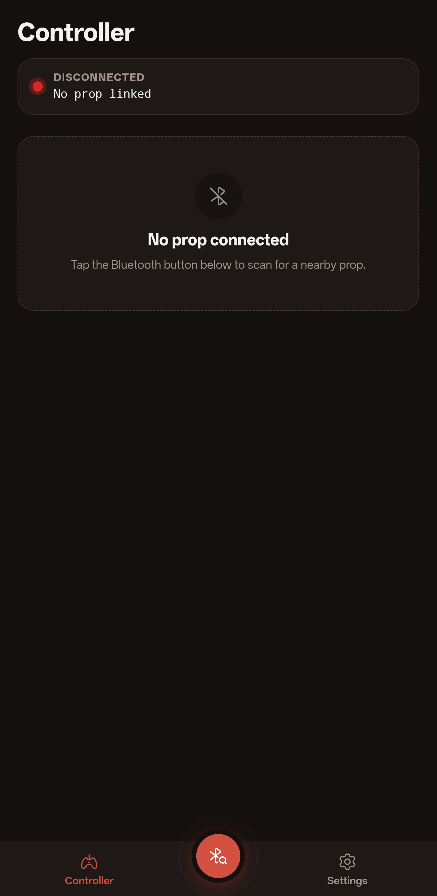
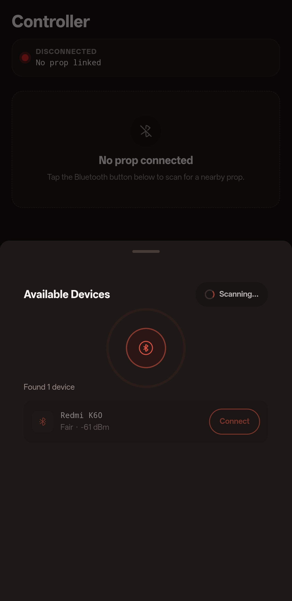
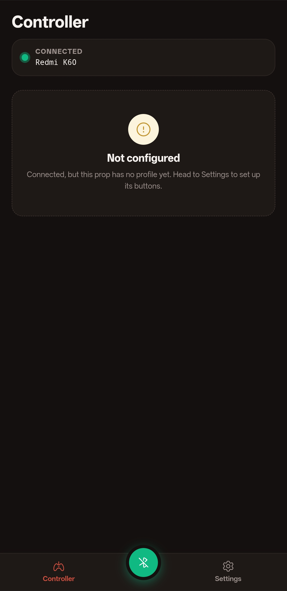
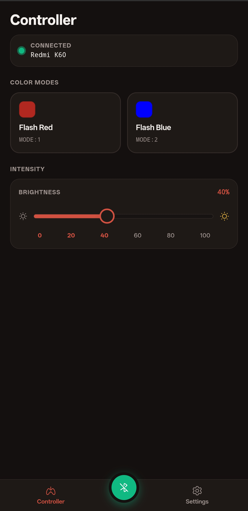
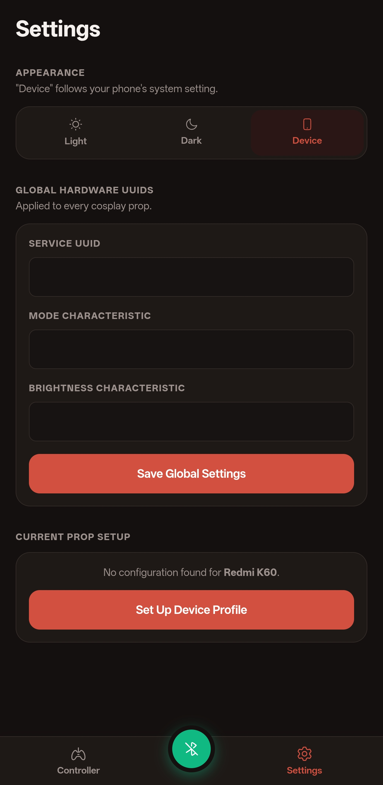
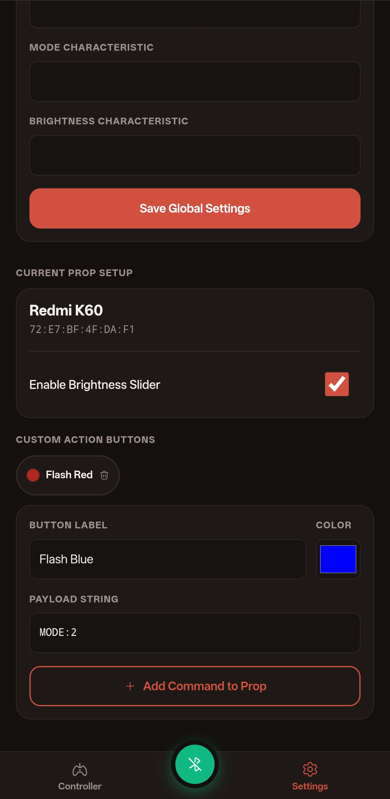

## Mission briefing

A friend commissioned me to build an app for his cosplay. The costume has LEDs driven by a microcontroller, and he wanted to change their settings from his phone. He is more familiar with hardware, so he programs the microcontroller himself while I build the app that talks to it. When I asked what he wanted to call the app, he did not have a name in mind either, so it is just the cosplay app.

## Screenshots

The service and characteristic UUIDs have been removed from the screenshots below for demonstration purposes. They need to be set before the app can connect to a device.

View screenshots

## Field notes

The app talks to the microcontroller over Bluetooth Low Energy (BLE), which makes the phone a remote for the LEDs. It is built with Svelte and wrapped with Capacitor so it runs as a native mobile app, and GitHub Actions compiles it, so I never had to set up a mobile build environment by hand.

My first commit was on 31 August and my latest was on 20 September. That looks like a long time for a small app, but most of it was waiting. My friend needed to work out more of what he wanted before I fully committed, so we spent a while discussing the details to be sure of everything first.

## Squad

Just me, building for one client who was also the user.
