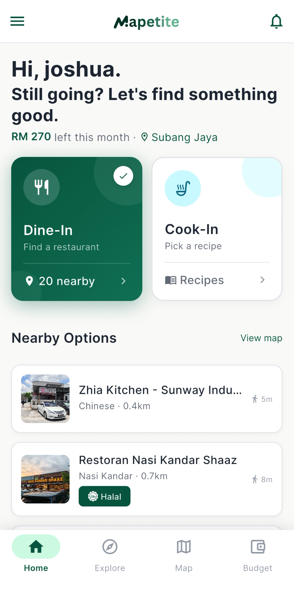
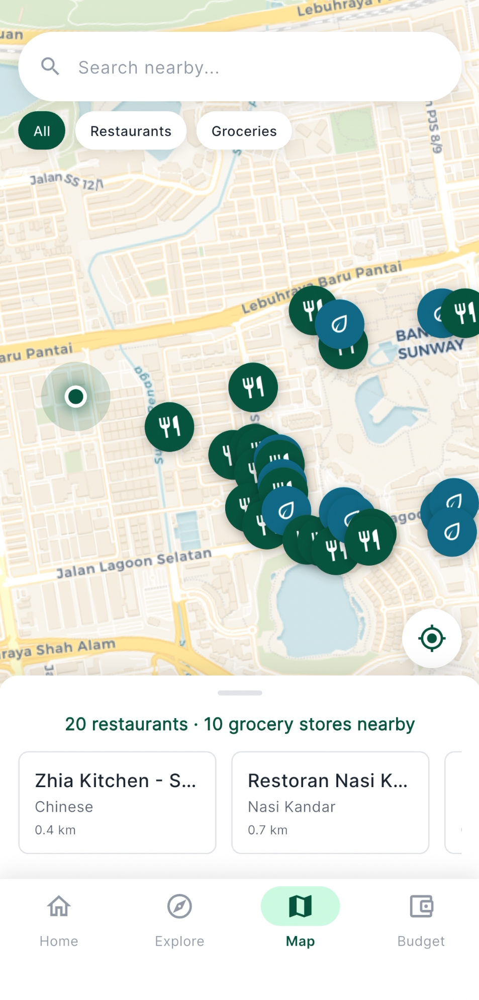
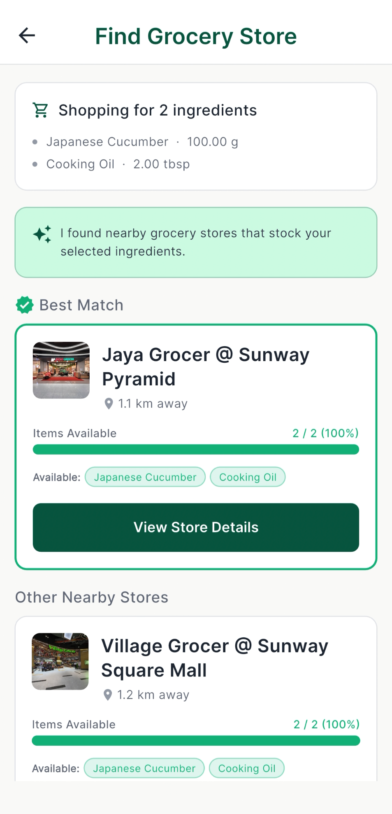
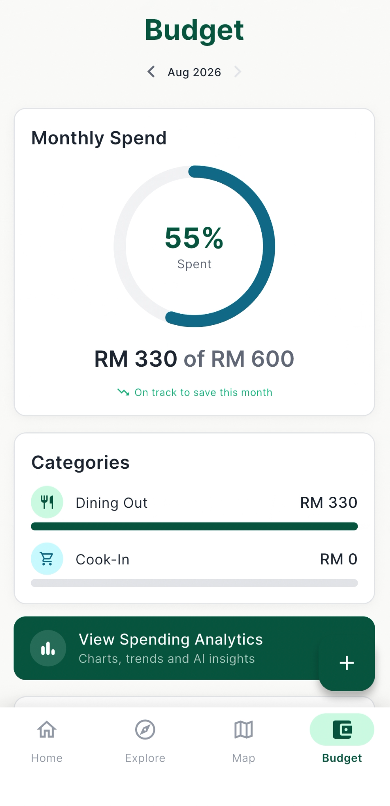
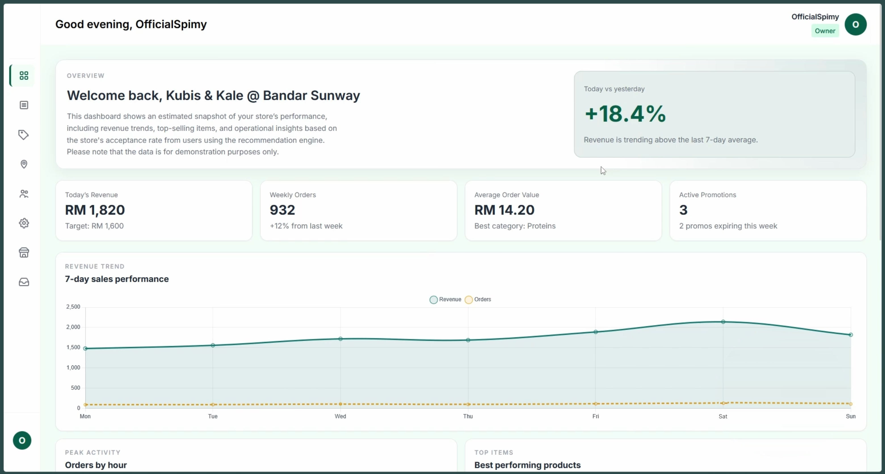
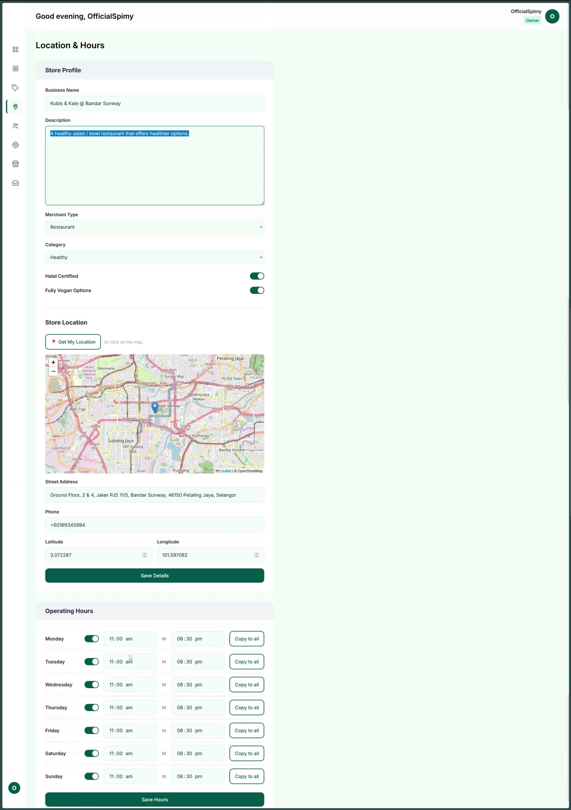

## Mission briefing

Working professionals and university students often eat out on impulse, which hurts both their budgets and their health. Cooking at home would help, but finding a recipe and buying the ingredients puts people off. Mapetite sits between the two: instead of making users search, it surfaces restaurants and grocery stores that fit their preferences, budget and location.

It is deliberately a discovery, recommendation and budgeting tool. It is a read-only catalogue, and payments and food delivery are handled outside the app.

## Screenshots

Mobile app screenshots taken on iPhone, courtesy of Joshua. All screenshots are for demonstration purposes only and do not necessarily reflect real data.

View screenshots

 

 

## Field notes

- **One backend, two frontends.** The Django backend holds all the business logic. The mobile app reaches it only through a JSON REST API, while the merchant and admin dashboards are rendered by Django itself. The dashboards use progressive enhancement, so their core features work without client-side JavaScript.
- **Signing in.** In the app, users can register with an email and password or sign in with Google, and both follow industry-standard practices. The app uses JWT access and refresh tokens, while the dashboards use normal sessions.
- **The merchant dashboard.** Merchants manage their store, menu, inventory, promotions and staff. Store owners invite their staff by email, and the invitation link works once and expires after a few days.
- **Onboarding new stores.** Store owners cannot sign up on their own. They contact Mapetite's customer success team through the contact page to ask for a demo and talk business, and then an admin creates their merchant account. After that, they can claim more stores themselves, such as chain stores, through an onboarding flow: they find the store in the listings and send a claim request with proof that it is theirs, which an admin reviews and approves or rejects.
- **Separate Django apps.** Users, merchants, recipes, budgets and notifications each live in their own app, so a change to one, such as notifications, does not touch another, such as ingredient matching.
- **Location and meaning in the database.** PostgreSQL does the heavy lifting. PostGIS finds stores near the user, `pgvector` matches meaning instead of exact words (a recipe's "milk" can match a store's "dairy"), and `pg_trgm` handles fuzzy text search.
- **Recipes to groceries.** Pick a recipe and the system finds nearby grocery stores, matches the ingredients against their inventory, and has Gemini explain in plain language why each store was recommended. Restaurant recommendations are a separate feature that ranks nearby restaurants against the user's diet, cuisine, budget and health goals.
- **A documented contract.** The mobile app and the backend were built in parallel, so the API was the agreement between them. Its OpenAPI schema is generated from the code with drf-spectacular and served as Swagger UI and Redoc behind a staff login, so the documentation cannot drift out of date. Postman covered what documentation could not, such as testing Google sign-in by hand.
- **One command to run it.** PostGIS and `pgvector` are awkward to install by hand, and Django's spatial features need extra system libraries on top. So the backend was containerised from early on, and `docker compose up` brings up the Django app and a database with both extensions already set up. A dev container and a small Makefile wrap common tasks like migrations, seeding and generating embeddings. Nobody on the team had to set any of that up on their own machine, and the people building the app got the real API without touching the backend code.

## Timeline

The project ran from 17 May 2026 to early August 2026, in three sprints. The first two ended with a review session with our supervisor, and the third with an internal check that everything was stable before submission.

Planning did not go perfectly. Integration between the app and the backend uncovered dependencies we had not planned for, and some tasks turned out bigger than expected once someone was working inside them. Instead of cutting planned work, we moved target dates on the project board and aimed for fewer tasks that were properly finished by each review, rather than a long list left half done. New feature ideas that came up along the way went on a list for later instead, which is the [Next quest](#next-quest) below.

## Next quest

These are ideas we saw along the way but left out on purpose, so the scope would not creep and we could finish on time.

- **Real purchasing.** Payments and pickup or delivery, plus live stock and stock reservation, so that Mapetite stops being a read-only catalogue.
- **Grocery lists on the server.** They are stored on the device for now, so syncing them across devices would need server-side storage.
- **More ways to sign in.** Support for more OAuth providers, on top of email and password registration and Google sign-in.
- **Smarter recommendations.** Larger datasets, learning from user behaviour, and better ranking.
- **Routine-aware suggestions.** Geofencing, so the app could anticipate where a user usually is at certain times.
- **Community-added places.** Users could submit missing merchants for admin approval, and earn trusted status through accurate submissions.

## Squad

There were four of us. Joshua did the UI and UX, Justin gathered the stores and recipes that fill the database and built the restaurant recommendations, and Rohan did the integration between frontend and backend, plus testing.

I was the solution architect and built the entire backend with Django and Django REST Framework. I was also the project manager, tracking progress on a GitHub Projects board, which is something I learned to do properly during my internship. Every task started as a GitHub issue with its own branch, and every pull request needed a teammate's review before it could merge. For most of the project that was a team habit. We made it a hard rule with branch protection when the repository became public for assessment.
